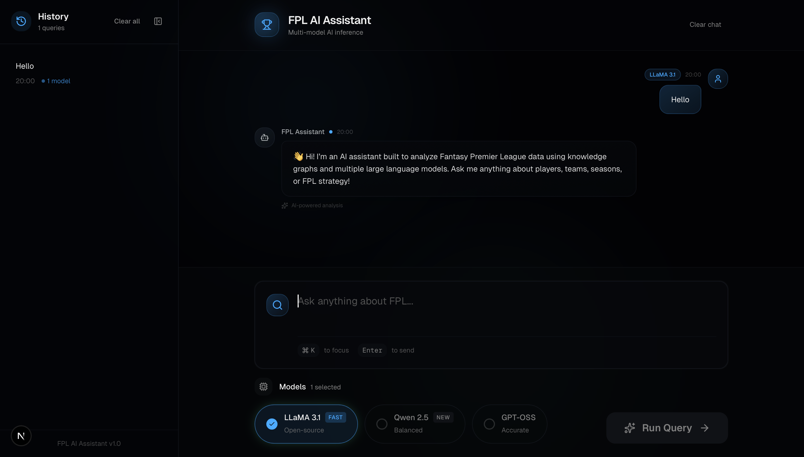
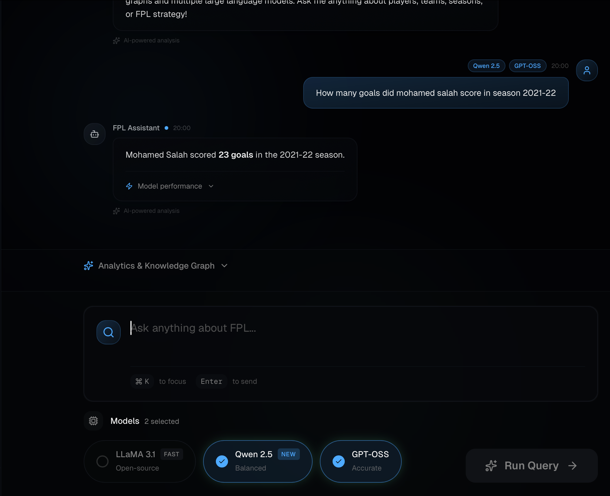
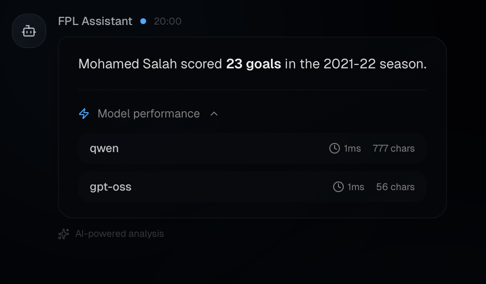
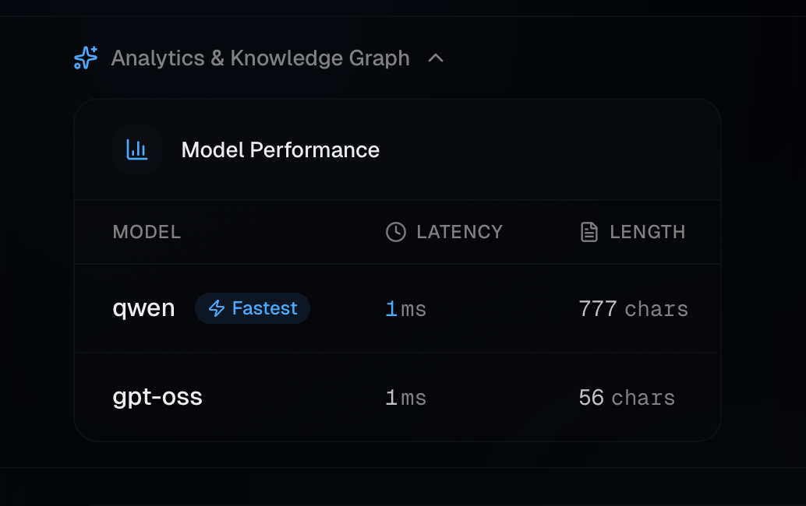
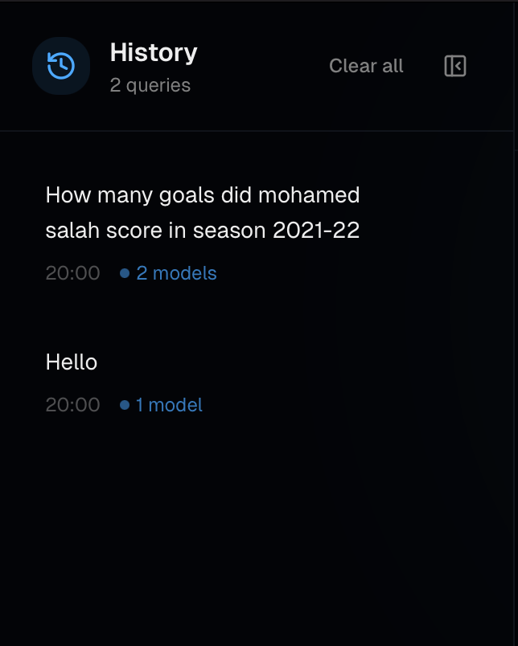

# ⚽ Fantasy Premier League Graph-RAG AI

A full-stack AI system that answers Fantasy Premier League (FPL) questions using a **Neo4j knowledge graph, embedding-based retrieval, and multiple large language models** — all wrapped in a production-grade web UI.

This project is not a toy chatbot.  
It is a **real Graph-RAG system** that understands football data structurally and reasons over it.

---

## 🚀 Features

- 🔗 **Knowledge Graph (Neo4j)** — players, teams, matches, stats, gameweeks  
- 🧠 **Graph-RAG pipeline** — combines Cypher queries + vector search  
- 🤖 **Multi-model LLM orchestration**
  - LLaMA
  - Qwen
  - GPT-OSS  
- 📊 **Model comparison**
  - Latency
  - Response length  
- 🕸 **Knowledge Graph visualization**  
- 💬 **Chat interface**  
- 🗂 **Query history**  
- ⚡ **FastAPI backend**  
- 🌐 **Next.js + Tailwind professional UI**

---

## 📸 Live Demo

<p align="center">
  <br/>
  <em>Chat Interface</em>
</p>

<p align="center">
  <br/>
  <em>Testing Queries</em>
</p>

<p align="center">
  <br/>
  <em>Multi-Model Performance</em>
</p>

<p align="center">
  <br/>
  <em>Analytics & Knowledge Graph</em>
</p>

<p align="center">
  <br/>
  <em>History Panel</em>
</p>

---

## ⚙️ How to run locally

### 1️⃣ Backend

From the project root, copy `config.example.txt` to `config.txt` and configure your Neo4j connection. Create a local `.env` file with `GROQ_API_KEY` set to your own key. The Neo4j graph and embeddings must be prepared before running the API. Never commit your local credentials.

From the project root:

```bash
uvicorn api:app --reload
```

Backend runs at:

```
http://localhost:8000
```

---

### 2️⃣ Frontend

```bash
cd fpl-ui
npm install
npm run dev
```

Open in your browser:

```
http://localhost:3000
```

---

## 🧪 Example queries

Try these in the UI:

- How many goals did Mohamed Salah score in 2022-23?
- Compare Haaland and Kane in 2022-23 by goals and points
- Which Arsenal players had the most goals in 2022-23?
- Who were the best budget midfielders?
- Hello
- Who are you?
- What can you do?

---

## 🏗️ Project Structure

```
api.py                # FastAPI backend entry point
kg/                   # Knowledge graph & preprocessing
retrieval/            # Cypher + embedding retrieval
llm/                  # LLM orchestration
fpl-ui/               # Next.js frontend
assets/               # Screenshots for README
```

---

## 🎯 Why this project matters

This system demonstrates **real-world AI engineering**:

- Graph-based RAG over structured data  
- Vector retrieval + Cypher working together  
- Multi-LLM orchestration  
- Production API layer  
- Modern SaaS UI  

These are the same techniques used in:

- Sports analytics platforms  
- Financial intelligence systems  
- Search engines  
- Enterprise AI assistants  

This is not a tutorial project — it is a **deployable AI product**.

---

## Project Developers

This project was collaboratively developed by:

- [Mohamed Hesham](https://github.com/moheshhamm)
- [Youssef Eslam](https://github.com/Youssefeslamm)

Original repository: [Fantasy-Premier-League-RAG](https://github.com/Youssefeslamm/Fantasy-Premier-League-RAG).

This repository is a portfolio copy of the collaborative project.

---

## ⭐ Support

If you find this project useful or impressive, please star the repository — it helps it get noticed and supports future development.
